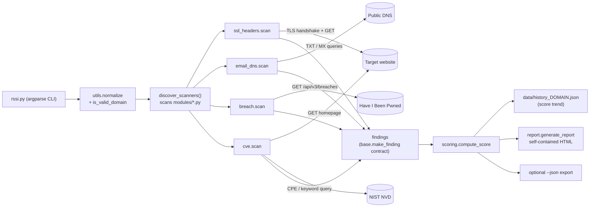

# RSSI Audit: passive external security audit for small businesses

A command-line tool written in Python that assesses the **external** security posture of a
small or medium business from **public data only**. It sends no attack traffic and does no
port scanning. It returns a **score out of 100**, a **grade from A to F**, and a self-contained
HTML report that a non-technical business owner can read.

"RSSI" is the French acronym for CISO (*Responsable de la Sécurité des Systèmes
d'Information*). The project is meant as a "virtual CISO" for SMEs that have no security
staff. Reports are written in French because the target market is French-speaking SMEs in
Morocco and France.

> **Ethics.** Only audit domains you own or have written permission to assess. Every check
> is passive: one normal HTTPS page load, one TLS handshake, public DNS queries and two
> public databases. See [Ethics and legal use](#ethics-and-legal-use).

---

## What it checks

| Area | Module | Checks |
|---|---|---|
| **SSL/TLS** | `modules/ssl_headers.py` | HTTPS reachable on 443, certificate chain validation against the Mozilla root store (certifi), expiry (< 15 / < 30 days), issuer, CN/SAN match including wildcards, negotiated protocol (SSLv3, TLS 1.0 and 1.1 fail) |
| **HTTP security headers** | `modules/ssl_headers.py` | `Strict-Transport-Security`, `Content-Security-Policy`, `X-Frame-Options`, `X-Content-Type-Options`, `Referrer-Policy`, `Permissions-Policy`, version disclosure in `Server` and `X-Powered-By`, HTTP to HTTPS redirect |
| **Email anti-spoofing** | `modules/email_dns.py` | SPF present and its `all` qualifier (`-all`, `~all`, `?all`, `+all`), DMARC policy (`none`, `quarantine`, `reject`), DKIM on 5 common selectors, MX records |
| **Public breaches** | `modules/breach.py` | Whether the domain or a sub/parent domain appears in the public Have I Been Pwned breach catalogue (free endpoint, no API key) |
| **CVE matching** | `modules/cve.py` | Detects exposed versions (`Server`, `X-Powered-By`, `<meta name="generator">`) and queries the NIST NVD 2.0 API: version-exact CPE match for known products, keyword fallback (labelled "to verify") for the rest |

Each finding follows a fixed data contract (`base.make_finding`):

```text
id, category, title, severity, status, detail, patron, reco, evidence
```

`detail` is the technical explanation, `patron` is the plain-language version for the
business owner ("patron" means boss in French), `reco` is the fix and `evidence` is the
raw observation (header value, DNS record, CVE IDs).

## Scoring method

The score starts at **100**. Each finding with status `fail` or `warn` subtracts the weight
of its severity (`base.SEVERITY_WEIGHTS`):

| Severity | `fail` | `warn` (half, rounded) |
|---|---|---|
| `critique` (critical) | −40 | −20 |
| `eleve` (high) | −25 | −12 |
| `moyen` (medium) | −12 | −6 |
| `faible` (low) | −5 | −2 |
| `ok` / `info` | 0 | 0 |

`pass` and `info` findings never subtract points. The score is clamped to `[0, 100]`.
Python's `round()` rounds half to even, so 12.5 becomes 12 and 2.5 becomes 2.

| Score | Grade | Report colour |
|---|---|---|
| ≥ 90 | A | green |
| ≥ 75 | B | green |
| ≥ 60 | C | orange |
| ≥ 40 | D | orange |
| ≥ 20 | E | red |
| < 20 | F | red |

Inconclusive checks are reported as `info` so they do not lower the score. Examples are a
DKIM selector that cannot be guessed, an API that is unreachable, or an approximate CVE
match whose severity is capped at `moyen`. The point is to avoid penalizing a site for a
limitation of the tool itself.

## Architecture

Scanners are **plugins discovered at runtime**. Any `modules/<name>.py` file that exposes
`scan(domain: str, base_url: str) -> list[dict]` is loaded and run, with no registration
step. Files whose names start with `_` are ignored. Each scanner runs in isolation, so one
that crashes is logged and the audit carries on.



| File | Role |
|---|---|
| `rssi.py` | CLI and orchestration: discovery, isolated execution, history, summary |
| `base.py` | Finding contract and validation, severity weights |
| `utils.py` | `fetch_url` (never raises), `dns_txt` (dnspython with an `nslookup` fallback), `normalize`, `is_valid_domain` |
| `scoring.py` | Score, grade and per-severity counts |
| `report.py` | Standalone HTML report (inline CSS, no CDN, all values HTML-escaped) |
| `modules/` | Scanner plugins |
| `tests/` | 133 pytest tests, all offline |

### Adding a check

```python
# modules/robots_txt.py
from base import make_finding
import utils

def scan(domain: str, base_url: str) -> list:
    resp = utils.fetch_url(base_url + "/robots.txt")
    ok = resp is not None and resp.status_code == 200
    return [make_finding(
        id="robots_txt", category="General",
        title="robots.txt present" if ok else "robots.txt absent",
        severity="ok" if ok else "info", status="pass" if ok else "info",
        detail="...", patron="...", reco="...", evidence="")]
```

Drop the file into `modules/` and it runs on the next audit.

## Installation

Requires Python 3.9 or later.

```bash
git clone <this-repo> rssi-audit && cd rssi-audit
python -m venv .venv && source .venv/bin/activate   # Windows: .venv\Scripts\activate
pip install -r requirements.txt
```

## Usage

```bash
python rssi.py example.com                          # report saved to reports/
python rssi.py https://example.com/ -o out --json out/example.json
python rssi.py example.com --only email_dns         # one scanner only
python rssi.py example.com --skip cve,breach        # no third-party API calls
python rssi.py example.com --no-history             # do not read or write data/
python rssi.py --list-modules
python rssi.py --help
```

| Exit code | Meaning |
|---|---|
| 0 | audit completed |
| 2 | invalid or missing domain |
| 3 | no scanner found |
| 130 | interrupted (Ctrl+C) |

Each run appends the score to `data/history_<domain>.json`. The next run prints the change
(for example `+12 points since the last audit`) and the HTML report shows the trend.

## Sample output

This is a real passive run against **rotaskitchen.com**, a site owned by the author. Full
files: [`examples/`](examples/). The HTML report is
[`examples/rapport_rotaskitchen.com.html`](examples/rapport_rotaskitchen.com.html) and a
commented excerpt is in [`examples/rotaskitchen.com-excerpt.md`](examples/rotaskitchen.com-excerpt.md).

```text
>>> Audit passif de : rotaskitchen.com  (https://rotaskitchen.com)
  Scanners charges : breach, cve, email_dns, ssl_headers

>>> Execution des scanners ...
  [+] breach         -> 3 finding(s)
  [+] cve            -> 4 finding(s)
  [+] email_dns      -> 4 finding(s)
  [+] ssl_headers    -> 12 finding(s)

================================================================
  RSSI VIRTUEL PME - RESUME DE L'AUDIT
================================================================
  Domaine        : rotaskitchen.com
  Findings total : 23

  SCORE   : 🔴  37 / 100   (note E)

  Repartition par gravite :
     - eleve     : 1
     - moyen     : 4
     - faible    : 6
     - ok        : 7
     - info      : 5

  TOP 3 PROBLEMES A TRAITER :
     1. [eleve] DMARC present mais inactif (p=none, mode surveillance)
     2. [moyen] En-tete HSTS absent
     3. [moyen] Versions logicielles exposees publiquement
```

The TLS setup is sound (TLS 1.3, valid Let's Encrypt certificate, HTTPS redirect) and the
domain appears in no known breach. The low grade comes from email policy (DMARC `p=none`,
SPF `~all`), four missing headers, and PHP, WordPress and Elementor versions being
disclosed.

## Testing

```bash
python -m pytest
```

The **133 tests run fully offline**. An autouse fixture in `tests/conftest.py` replaces
`socket.create_connection`, `socket.connect` and `getaddrinfo`, so any accidental network
call fails the test. HTTP responses, DNS answers, TLS handshake results, and the HIBP and
NVD payloads are all mocked. The tests cover:

- scoring: weights, half-weight warnings, clamping, every grade boundary, malformed input
- finding contract validation
- the parsers: nslookup TXT/MX output, SPF qualifier, DMARC policy, `Server`, `X-Powered-By`
  and `generator` version extraction, CVSS v3.1/v3.0/v2 extraction, wildcard certificate
  name matching, certificate dates
- the decision logic of each module: certificate expiry thresholds, broken chain versus
  invalid certificate, missing headers, breach matching on sub-domains, CPE versus keyword
  NVD queries, the 429 retry, downgrading approximate CVE matches
- the orchestrator: plugin discovery, crash isolation, history, exit codes, an offline
  end-to-end run, and HTML escaping in the report

## Limitations

- **External view only.** The tool sees what anyone on the Internet sees. It does not
  check internal networks, patch levels that are not disclosed, backups, user accounts or
  application logic. A good score does not mean the site is secure.
- **Single page.** Headers and versions are read from the homepage only.
- **Presence, not quality, of headers.** A weak policy still passes. For example
  `Content-Security-Policy: upgrade-insecure-requests` provides no XSS protection.
- **Exposed versions are counted more than once.** A disclosed version is penalized in
  Headers (`Server`/`X-Powered-By`) and again for each product in CVE.
- **CVE false positives and false negatives.** Version-exact CPE matching only works for
  the products in `CPE_MAP`. Other products fall back to keyword search, which can match
  unrelated CVEs. Distributions such as Debian and Ubuntu backport fixes without changing
  the version string, so `Apache/2.4.41 (Ubuntu)` may already be patched. Missing
  version strings give no signal at all. Results are capped at 5 CVEs per product and
  4 products per run because of NVD's public rate limit.
- **DKIM selectors cannot be enumerated.** Only 5 common selectors are tried, so "not
  found" is reported as `info`.
- **Breach data covers domains, not accounts.** Only the public HIBP breach catalogue is
  read. Checking individual addresses needs a paid HIBP key and is intentionally not done.
- **Point-in-time snapshot.** Results depend on DNS caching, CDNs and how reachable the
  APIs are at the time of the run.
- **Subtractive scoring is harsh.** Many small issues can produce a low grade even with no
  critical one. The weights are a judgement call, not an industry standard.

## Ethics and legal use

- Only audit domains **you own** or have **explicit, preferably written, authorization** to
  assess.
- The tool is passive by design. It makes one TLS handshake, two HTTP GETs (HTTPS homepage
  and the HTTP redirect test), public DNS lookups and requests to public HIBP and NVD
  endpoints. It sends no payloads, brute-forces nothing and scans no ports.
- No paid APIs are called and no credentials are needed.
- Generated reports can describe weaknesses of third-party systems. `reports/` and
  `data/` are git-ignored on purpose, so do not publish them without the owner's consent.
- Laws on unauthorized access differ by country (for example Morocco's law 07-03 and
  France's Code pénal articles 323-1 and following). Passive does not mean authorized.

## Roadmap

- [ ] Grade header quality as well as presence (HSTS `max-age`/`preload`, CSP directives)
- [ ] Remove the double counting of version exposure in the score
- [ ] Extra passive checks: DNSSEC, CAA records, MTA-STS/TLS-RPT, BIMI, `security.txt`,
      cookie flags (`Secure`, `HttpOnly`, `SameSite`)
- [ ] Certificate Transparency lookup (crt.sh) to list forgotten sub-domains
- [ ] Optional NVD API key support (higher rate limit) and local CVE caching
- [ ] English report template, PDF export and a JSON schema for findings
- [ ] Packaging (`pyproject.toml`, `rssi` entry point) and CI with GitHub Actions

---

## Résumé en français

**RSSI Audit** est un outil Python d'audit de sécurité **externe et passif** destiné aux
PME. À partir de données publiques uniquement, il vérifie le certificat SSL/TLS, les
en-têtes HTTP de sécurité, la protection anti-usurpation des emails (SPF, DKIM, DMARC, MX),
la présence du domaine dans les fuites publiques (Have I Been Pwned) et les CVE associées
aux versions logicielles exposées (NVD). Il calcule un **score sur 100** (note de A à F) et
génère un **rapport HTML en langage clair** pour le dirigeant, avec pour chaque constat une
explication simple, l'action à mener et le détail technique. Les scanners sont des
**plugins découverts automatiquement** dans `modules/`. Les 133 tests unitaires
s'exécutent sans réseau. **N'auditez que des domaines qui vous appartiennent ou pour
lesquels vous avez une autorisation explicite.**

## Author

**Mohamed Elansari**, engineering student in cybersecurity, Universiapolis Agadir.
Contact: mrmohamedelansari@gmail.com

## License

[MIT](LICENSE)
